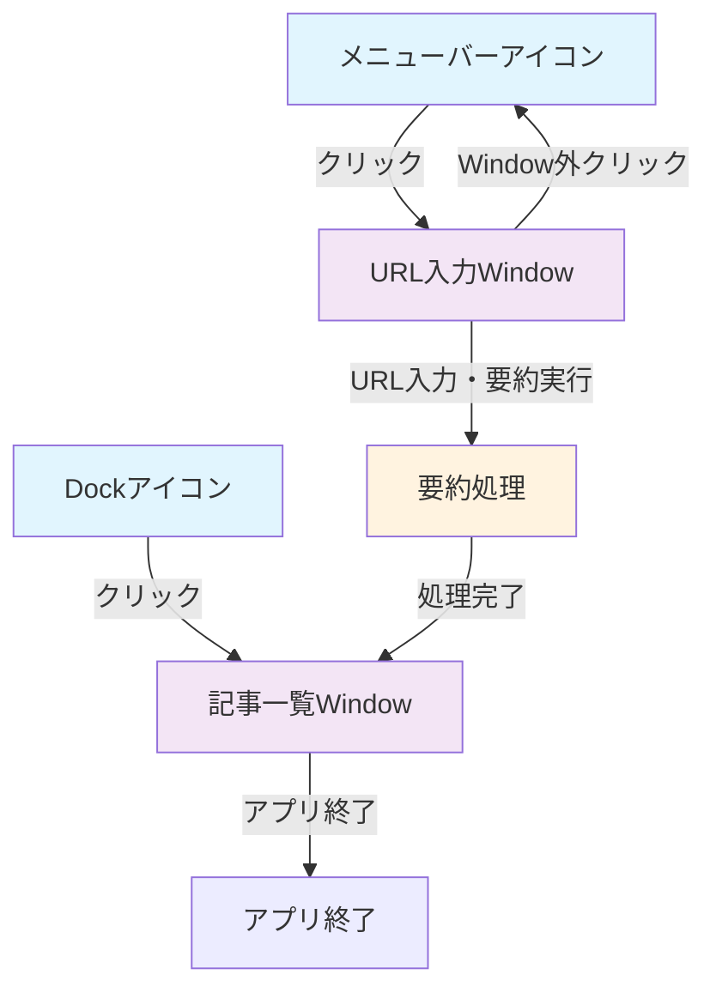

# 画面設計・画面遷移図

## 必要な画面一覧

### 1. URL入力Window（メニューバーアイコンから起動）
- **役割**: 要約したい記事のURLを入力するためのWindow
- **起動方法**: メニューバーのアイコンをクリック
- **閉じる動作**: Window外をクリックすると自動的に閉じる
- **主な機能**:
  - URL入力フィールド
  - 要約実行ボタン
  - 進捗表示

### 2. 記事一覧Window（Dockアイコンから起動）
- **役割**: 要約された記事の管理や、読書を行うためのWindow
- **起動方法**: DockまたはLaunchpadのアイコンをクリック
- **主な機能**:
  - 要約された記事一覧
  - 記事詳細表示
  - 読書機能
  - 記事管理（削除、カテゴリ分けなど）

## 画面遷移図

## Window間の連携
- URL入力Windowで要約を実行した後、記事一覧Windowに結果を反映
- 両Windowは独立して開閉可能
- メニューバーアイコンは常駐し、素早いURL入力を可能にする
- URL入力WindowはWindow外クリックで自動的に閉じる（ポップオーバー形式）
